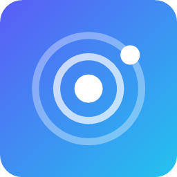
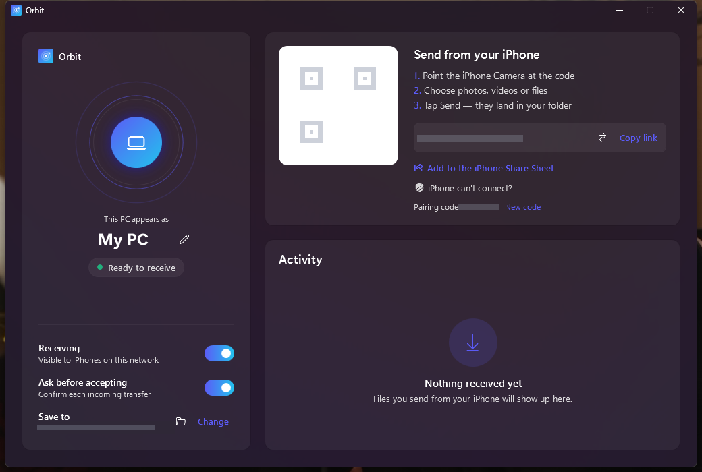
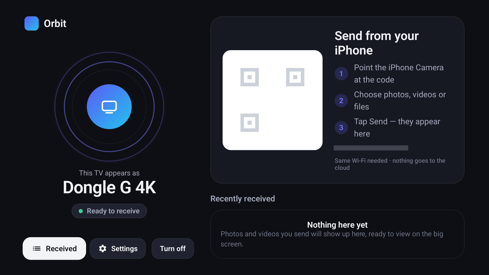
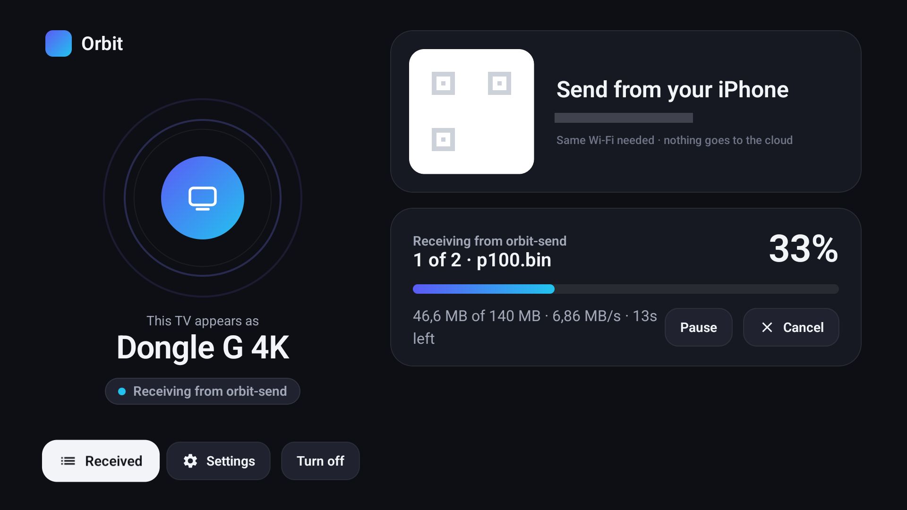
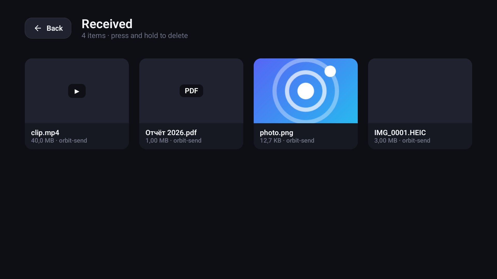
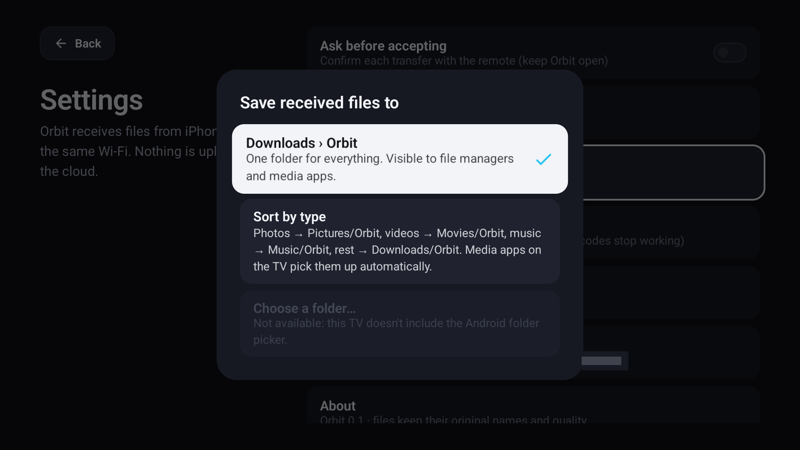

<div align="center">



# Orbit

**Передача фото, видео и файлов с iPhone на Windows и Android TV / Google TV — по Wi-Fi, без проводов, облака и аккаунтов.**

[](https://github.com/Obn4zh/Orbit/actions/workflows/ci.yml)
[](https://github.com/Obn4zh/Orbit/releases/latest)
[](LICENSE)


[Скачать](https://github.com/Obn4zh/Orbit/releases/latest) · [Как это работает](docs/ARCHITECTURE.md) · [Протокол](docs/PROTOCOL.md) · [Безопасность](#безопасность)

</div>

<p align="center">
  
  
</p>

## Возможности

- **Без установки на iPhone** — камера → QR-код → выбрать файлы → Send.
- **В меню «Поделиться»** через Shortcuts: Фото → Поделиться → Orbit → навести на QR. Видео уходят в оригинальном качестве.
- **Оригиналы без сжатия**, исходные имена файлов, несколько файлов за раз, файлы в несколько ГБ.
- **Докачка** после обрыва Wi-Fi, пауза и отмена на приёмнике, скорость и оставшееся время.
- **Подтверждение каждой передачи** (Accept / Decline) — с мыши или с пульта ТВ.
- **Windows 11-стиль**: Mica, светлая/тёмная тема, работа из трея, уведомления.
- **Интерфейс для ТВ**: управление пультом, крупный QR, встроенный просмотр фото, история полученного.
- **Настраиваемая папка**: любая на Windows; на ТВ — «Загрузки», раскладка по типам (Фото/Видео/Музыка) или своя папка, если ТВ это поддерживает.

> **Это не AirDrop.** Сторонние устройства не могут появиться в нативном интерфейсе AirDrop без закрытых протоколов Apple. Почему — в [исследовании](docs/AIRDROP-FEASIBILITY.md). Orbit — ближайшая к AirDrop практическая альтернатива.

## Установка

| Платформа | Файл | Как установить |
|---|---|---|
| **Windows 10/11** | `Orbit-Setup-x.y.z.msi` | Запустите и пройдите мастер. SmartScreen: «Подробнее» → «Выполнить в любом случае» (установщик не подписан) |
| **Android TV / Google TV** | `Orbit-tv.apk` | `adb connect <IP-ТВ>:5555` → `adb install Orbit-tv.apk`, либо через файловый менеджер на ТВ |
| **iPhone** | — | Ничего ставить не нужно |

Все файлы — на странице [Releases](https://github.com/Obn4zh/Orbit/releases/latest).

## Как отправить с iPhone

**Вариант 1 — через страницу (без настройки)**
1. Откройте Orbit на ПК или ТВ. iPhone должен быть в той же Wi-Fi.
2. Наведите камеру на QR-код → откройте ссылку.
3. **Photos & Videos** или **Files** → **Send** → **Accept** на приёмнике.

**Вариант 2 — из меню «Поделиться» (настраивается один раз)**

В приложении **Команды** создайте команду «Orbit»:
```
ⓘ → Показывать в меню «Поделиться» (Изображения, Медиа, Файлы)
Сканировать QR-код или штрихкод
Повторить для каждого объекта в «Входные данные команды»
    Получить содержимое [QR-код / штрихкод]
        Метод: POST · Тело запроса: Форма · file (Файл) = Повтор объекта
Конец повтора
```
Дальше: Фото → **Поделиться** → **Orbit** → навести на QR → **Accept**.

> Safari сжимает видео из медиатеки и долго готовит длинные ролики. Для больших видео удобнее вариант 2.

## Скриншоты

<p align="center">
  
  
</p>
<p align="center">
  
</p>

## Безопасность

Рассчитано на **домашнюю сеть**:

- Отправить может только тот, у кого есть **код сопряжения из QR** (8 символов; при подборе блокировка после 20 попыток в минуту), и только после **Accept** на приёмнике.
- Принимаются подключения **только из локальной сети**. На Windows приём **приостанавливается в «Общественной» сети**, на ТВ — **в Wi-Fi без пароля**. Установщик открывает брандмауэр только для частных сетей и локальной подсети.
- Имена файлов очищаются (никаких `../`), существующие файлы **не перезаписываются**, файл появляется только после полной загрузки.
- На Windows полученные файлы помечаются как **«из интернета»**: SmartScreen и Office предупредят перед запуском.
- Трафик **не шифруется** (HTTP). В домашней сети с паролем на Wi-Fi это приемлемо; в чужих сетях Orbit сам не принимает файлы. Подробнее — [ARCHITECTURE.md](docs/ARCHITECTURE.md).

Нашли уязвимость — откройте issue без технических деталей, обсудим, как передать их приватно.

## Сборка из исходников

<details>
<summary><b>Windows</b> — .NET 10 SDK, для MSI — WiX Toolset v3</summary>

```bash
cd windows
dotnet test Orbit.Core.Tests            # интеграционные тесты протокола
dotnet run --project Orbit.Windows      # запуск
```
Портативный exe и установщик:
```bash
powershell -ExecutionPolicy Bypass -File tools/build-installer.ps1   # → dist/Orbit-Setup-<версия>.msi и dist/windows/Orbit.exe
```
Настройки: `%APPDATA%\Orbit\settings.json`. Файлы по умолчанию: `Загрузки\Orbit`.
</details>

<details>
<summary><b>Android TV / Google TV</b> — JDK 17, Android SDK 35</summary>

```bash
cd android-tv
./gradlew assembleRelease      # → app/build/outputs/apk/release/app-release.apk
adb install -r app/build/outputs/apk/release/app-release.apk
```
Путь к SDK — через `ANDROID_HOME` или `android-tv/local.properties` (`sdk.dir=…`). Файлы сохраняются через MediaStore в `Download/Orbit`, разрешения на Android 10+ не нужны.
</details>

<details>
<summary><b>Тестовый отправитель</b> — Node.js 18+</summary>

```bash
node tools/orbit-send.mjs --to <IP>:47717 --key <КОД> файлы…
node tools/orbit-send.mjs --to <IP>:47717 --key <КОД> --drop-at 104857600 big.mov   # обрыв + докачка
```
</details>

## Структура

| Папка | Что внутри |
|---|---|
| [`windows/Orbit.Windows`](windows/Orbit.Windows) | Приложение Windows (WPF .NET 10, Fluent / Mica, трей) |
| [`windows/Orbit.Core`](windows/Orbit.Core) | Протокол, сервер Kestrel, логика передач |
| [`windows/Orbit.Core.Tests`](windows/Orbit.Core.Tests) | Тесты протокола end-to-end |
| [`windows/Orbit.Installer`](windows/Orbit.Installer) | MSI (WiX) |
| [`android-tv`](android-tv) | Приложение Android TV (Kotlin, Compose for TV, Ktor) |
| [`shared/web`](shared/web) | Страница отправителя для iPhone, встраивается в оба приложения |
| [`tools`](tools) | Сборка установщика, генерация иконок, тестовый отправитель |
| [`docs`](docs) | [Архитектура](docs/ARCHITECTURE.md) · [Протокол](docs/PROTOCOL.md) · [Дизайн](docs/DESIGN.md) · [Тестирование](docs/TESTING.md) · [AirDrop](docs/AIRDROP-FEASIBILITY.md) |

## Ограничения

- Нет появления в нативном AirDrop.
- Safari перекодирует видео из медиатеки (HEIC → JPEG, видео сжимается); оригиналы — через «Поделиться» или «Files».
- Во время передачи из Safari страница должна оставаться открытой.
- На ТВ подтверждать передачу можно, только когда Orbit открыт (ограничение Android); при закрытом приложении запрос истекает через 90 с.
- Своя папка на ТВ доступна, только если в системе есть выбор папок (на многих Google TV его нет).
- На слабых ТВ-стиках скорость ограничена процессором: ~6–7 МБ/с.
- Сборки не подписаны сертификатом издателя.

## Лицензия

[MIT](LICENSE)
